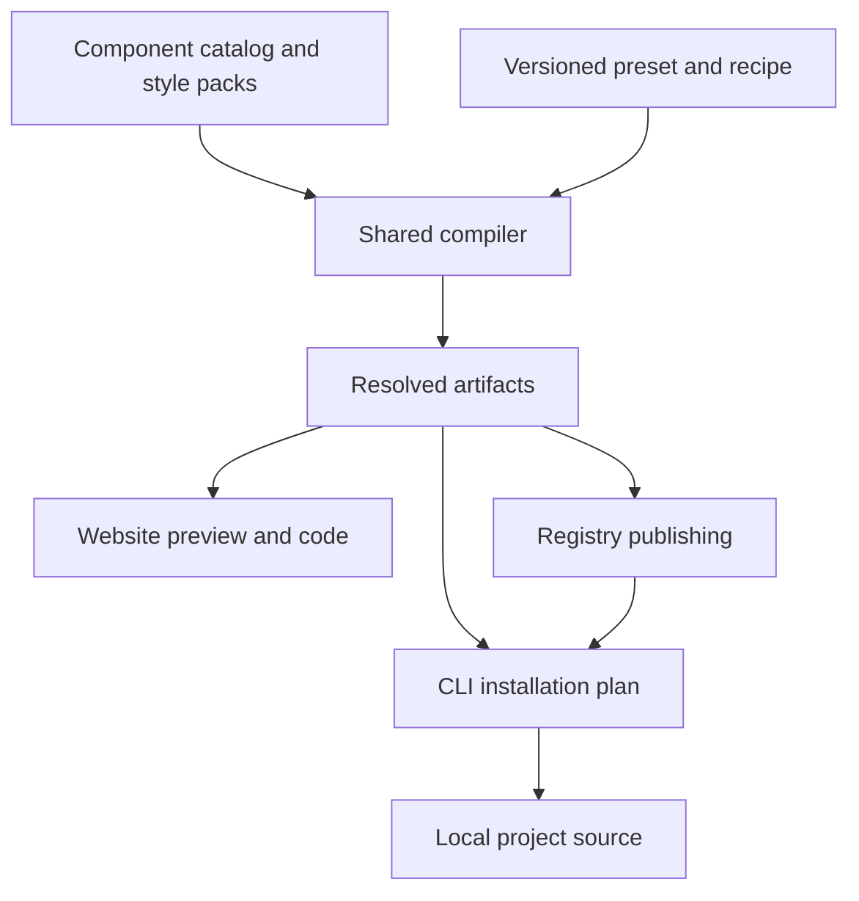

# System Architecture

## Architecture decision

Build a TypeScript monorepo containing the website, component catalog, preset contracts, compiler, registry output, and CLI. Installed applications receive local component and CSS files. They do not need a runtime connection to the website.

The shared compiler converts validated preset data and reviewed component templates into one artifact representation. The editor renders those artifacts, the code panel displays them, and the CLI installs them. Rendering an independently styled demonstration is insufficient.

## System map



The diagram describes responsibilities, not a requirement to run all compilation remotely. Built-in catalog artifacts are precompiled at release time. The editor can compile validated data locally using the same compiler version.

## Proposed stack

| Area | Baseline | Reason |
| --- | --- | --- |
| Language | TypeScript and TSX | Typed contracts shared by website, CLI, and generator |
| Web components | React with one pinned shadcn Radix-based edition | Start with one behavior and composition model |
| Styling | Tailwind CSS v4 and generated CSS custom properties | Familiar consumer customization with portable source |
| Variants | Existing shadcn conventions using class-variance-authority and a merge helper | Preserve predictable props and class composition |
| Website | Next.js with static documentation and client editor areas | Documentation, routing, export API, and React integration |
| Repository | pnpm workspaces | Keep packages independently testable without initial orchestration overhead |
| Consumer package managers | npm, pnpm, Yarn and Bun from alpha | Repository tooling does not restrict the consumer's manager |
| Contract validation | JSON Schema plus generated TypeScript validators or equivalent checked bindings | One public contract across browser and CLI |
| Tests | Vitest, Testing Library, Playwright, and axe integration | Compiler, component, install, visual, and accessibility evidence |
| Publishing | Static registry files and immutable snapshot storage | Cacheable public distribution |
| Snapshot service | One small API with object storage and lightweight relational metadata | No separate application backend required initially |

These are project recommendations. Pin exact Node, React, shadcn, TypeScript, Tailwind, primitive, and package manager versions during milestone M0 and commit the lockfile. Do not infer that the registry's cross-framework transport makes these React components framework-neutral.

## Repository responsibilities

| Location | Responsibility |
| --- | --- |
| `apps/www` | Docs, catalog, both editors, publish and resolve endpoints |
| `packages/contracts` | Preset, recipe, project config, artifact, and error contracts |
| `packages/tokens` | Token definitions, color validation, platform-neutral normalization |
| `packages/compiler` | Deterministic resolution and generation without filesystem or network access |
| `packages/catalog` | Authored TSX templates, public APIs, dependency metadata, editor controls |
| `packages/styles` | Flat, minimalist, neo brutalism, and glass recipes |
| `packages/cli` | Project detection, installation planning, conflict handling and writes |
| `packages/registry` | Build standard shadcn items and index from compiler output |
| `fixtures` | Next.js, Vite, later JSX and native consumer applications |
| `docs` | Product decisions, authoring rules, migrations, and release evidence |
| `skills` | Later agent instructions and versioned references |

Keep native implementations in `packages/catalog-native` when that track begins. Avoid empty packages for future features until needed.

## Integrating with shadcn

Reuse the registry schema, namespace configuration, source distribution conventions, and standard CLI install path. Standard registry items contain only upstream-supported fields. Keep product-specific preset, version, and recipe metadata in our own sidecar manifests.

The plain `shadcn add` path supports explicitly published component bundles and theme artifacts. It does not promise to read `ui-library.config.json`, maintain our lockfile, or resolve future additions against our custom preset automatically. Those guarantees belong to the product CLI.

Publish palettes as standard `registry:theme` items using `cssVars.light`, `cssVars.dark` and, where appropriate, `cssVars.theme`. This supplies an upstream installation route for existing shadcn projects. The product CLI's `theme add` route additionally saves the resolved project preset and guarantees the CSS merge and provenance behavior specified in this package.

Do not set `components.json.style` to `neo-brutalism` or another invented upstream style identifier. Preserve the valid upstream base/style configuration. Our `styleFamily` lives in our own preset. Existing projects using a different primitive family receive a compatibility error until an adapter is tested.

Current shadcn also provides its own preset and apply commands. Our JSON contract is not interchangeable with a shadcn preset code. M0 must investigate whether an adapter can reuse upstream preset handling without losing our extra tokens or recipe behavior.

### Installer reuse boundary

The CLI owns detection, validation, the installation plan, and conflict policy. Hide upstream interactions behind a versioned adapter. Prefer the supported CLI interface over importing undocumented internals.

In M0, prove that a pinned upstream CLI can resolve and transform a registry item in an isolated staging fixture. Prevent it from running an unrestricted installer in the user's project. Capture its transformed files and intended dependency changes, then create our exact reviewable plan. If this is not reliable, implement the small supported installation subset explicitly and record the divergence in an architecture decision.

Do not create a second general-purpose package manager or a full independent registry protocol. Unsupported cases should fail with actionable guidance.

## Compiler contract

Conceptual TypeScript interface:

```ts
type CompileInput = {
  catalogRelease: string
  compilerVersion: string
  target: "react-web"
  language: "tsx" | "jsx"
  preset: ValidatedPreset
  components: ComponentRequest[]
  recipe?: ValidatedRecipe
}

type Artifact = {
  logicalPath: string
  kind: "component" | "style" | "usage" | "utility"
  content: string
  sha256: string
}

type CompileResult = {
  artifacts: Artifact[]
  dependencies: DependencyRequirement[]
  warnings: Diagnostic[]
  provenance: BuildProvenance
}
```

Generation order is validate, resolve pinned releases, expand defaults, merge allowlisted overrides, check compatibility, generate source and CSS, format with a pinned formatter, and compute content hashes. Project paths and import aliases are applied in a later deterministic installation transform.

Do not include the current timestamp, random identifiers, machine paths, or network-dependent defaults in hashed content. Record operational timestamps separately. Freeze token defaults and output order in each catalog release.

## Component and style separation

Preserve one public component API and accessible behavior implementation per supported web primitive family. Static slot markers and reviewed CSS recipes determine visual styling. Presets compile to concrete CSS values and select reviewed recipes; they never inject arbitrary selectors or executable code.

Use complete literal Tailwind classes in source. Do not generate a runtime class such as `bg-${color}-500` and expect Tailwind to discover it. Dynamic editor values become validated CSS variables. Only the selected style recipe and required shared rules are exported.

Keep compatible style-family changes in CSS wherever possible. If a future style requires different markup, treat it as a source migration with a diff and compatibility boundary, rather than claiming a token-only update can perform it.

## Services and state

Documentation and built-in registry releases are static and public. Editing and JSON export work locally without authentication. A small publish API validates anonymous public snapshots, applies rate limits, and stores immutable payloads. No arbitrary server-side code compilation is needed in the first release.

Store snapshots by opaque ID plus immutable revision and content hash. Store mutable display names separately. Do not let a renamed preset change what an old installation command resolves. The CLI caches resolved artifacts and preset data locally for repeated pinned installs.

## Consumer project layout

Our CLI creates a separate `ui-library.config.json`, `ui-library.lock.json`, and a full resolved `ui-preset.json`. It merges global palette and token declarations directly into the stylesheet referenced by `components.json.tailwind.css`, usually `globals.css`. This applies to new setup and the dedicated existing-project theme path. Component recipes receive separate files such as `src/styles/ui-recipes/brutalist-primary-button.css`.

The compiler provides a declarative token patch; the CLI uses a CSS parser to update `:root`, the configured dark selector, and necessary Tailwind mappings in place. It preserves unrelated declarations, selectors, comments and imports. Track managed declarations individually rather than treating the entire pre-existing stylesheet as an owned generated file.

When a supported library style needs additional reviewed slot rules, write `ui-style.css` and add one import through a parsed change. Palette-only application to ordinary shadcn components must not depend on those slot rules. Existing components inherit tokens they already consume; complete visual-family transformations that need new classes or markup require a separate explicit migration. See the installation and theme merging specification.

The default preset scope is the application root; advanced nested scopes are deferred until portals and inheritance are proven. A theme-only operation does not install dependencies or rewrite component source.

## Reliability and security requirements

Use TLS and public immutable release manifests. Verify expected content hashes and reject traversal, symlink escapes, duplicate targets, dependency cycles, excessive payloads, and unknown artifact types before writing. Content hashes detect changed bytes; they are not proof of publisher identity. Add release signing when the distribution trust model requires it.

Snapshot data cannot carry executable instructions, external import URLs, fonts fetched from arbitrary hosts, or package names. Dependencies come from the reviewed catalog. Package managers can execute lifecycle scripts, so disclose the intended package operation and never represent source writes plus dependency installation as perfectly atomic.

The website must keep previews isolated from its own global CSS. The preview receives only a validated artifact ID and serializable preview state. Any later untrusted code editor requires a separate sandbox design.
