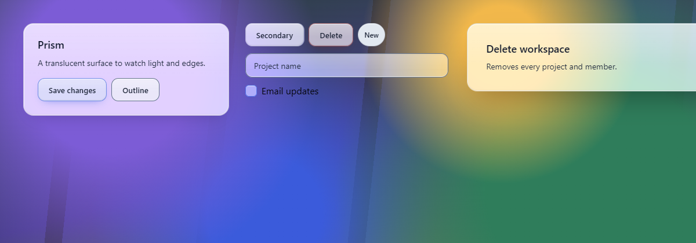
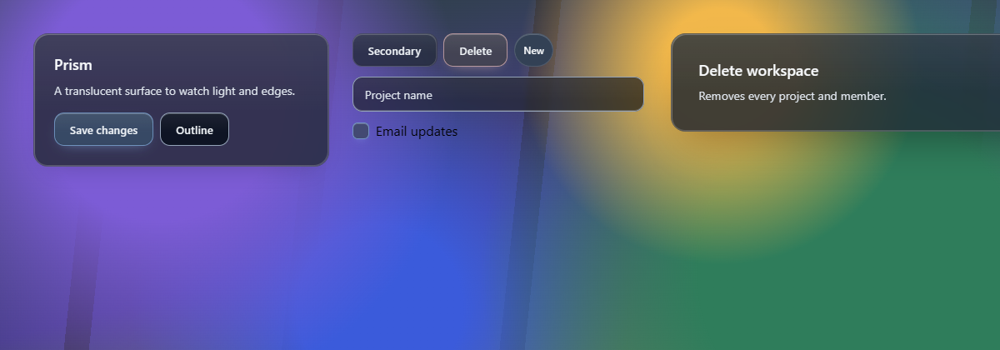
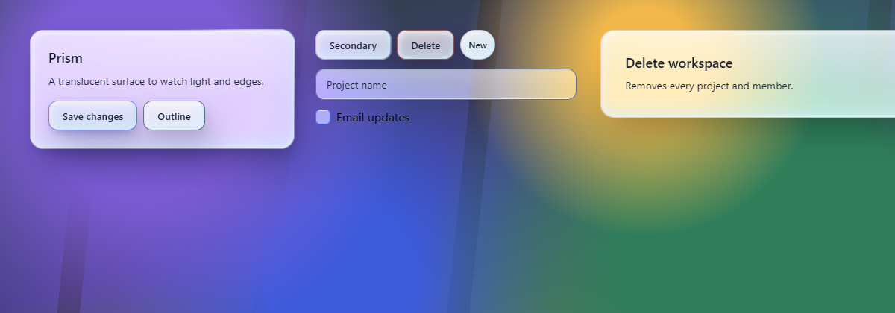
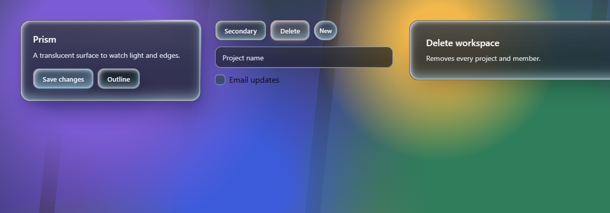

# Liquid glass material: evidence

5 November 2026, branch `feat/glass-material`. Windows 11, Node 24.19.0, pnpm 11.25.0, Playwright with Microsoft Edge.

## What changed

- **Six optional preset fields:** `glassRefraction`, `glassRefractionWidth`, `glassHalo`, `glassDepth`, `glassMotion` and `glassDispersion`. `glassBackdropContrast` now goes up to 1.6 and `glassSheen` up to 1.
- **Compiler tokens:** each new token is written only when its field is set: `--glass-refraction-strength`, `--glass-refraction-width`, `--glass-halo`, `--glass-depth`, `--glass-motion`, `--glass-dispersion`, `--glass-drop` and the `--glass-material` flag.
- **One shared material** in the family stylesheet, applied as Surface, Control and Mark recipes.
- **`LiquidGlassFilter`** gains pointer tracking for the halo and rim-only refraction.

## Checks

| Check | Result |
| --- | --- |
| `corepack pnpm typecheck` | pass |
| `VITEST_MAX_WORKERS=4 corepack pnpm test:unit` | 1136 of 1136 after the sheen bound in `apps/www/src/preset-editor/model.test.ts` moved to 1.01 (the first run failed only that assertion: 0.51 is now a valid sheen) |
| `preset-gallery-generation`, `preview-routing`, `hosted-preview-build`, `liquid-glass-cli`, `www-route` | 35 of 35 |
| `stable-families.test.ts` | unchanged and passing |
| Built-in preset tokens | byte-identical; pinned by SHA-256 in `liquid-glass material tokens` |

`test:e2e` was not run.

## Screenshots

The harness `.artifacts/shots/material.mts` compiles the glass family for Card, Dialog, Button, Badge, Input and Checkbox and renders static markup over the kit backdrop. It then lights the Card's halo near its top-right corner, as `LiquidGlassFilter` would.

| Preset | Light | Dark |
| --- | --- | --- |
| Built-in, unchanged |  |  |
| Built-in plus every material field at 0.6, refraction width 0.18 |  |  |

- **Built-in:** these render as before. No halo shows, because `--glass-halo` is not set.
- **Material draft:** it adds relief, a rim colour fringe, deeper shadows and the Card halo.

## Limits

- **Refraction:** it is not visible in these static pages, because the halo is set by hand and no `LiquidGlassFilter` is mounted. The rim map and the pointer helpers are covered by `packages/catalog/test/liquid-glass-filter.test.ts`; the listener wiring itself has no unit test, because no DOM environment is installed.
- **Starting presets and editor controls:** they come in the next two PRs.
