# Liquid glass starting presets: evidence

5 November 2026, branch `feat/glass-presets`. Windows 11, Node 24.19.0, pnpm 11.25.0, Playwright with Microsoft Edge.

## What changed

- **Eight starting presets** in `packages/catalog/src/presets/`, listed by `startingPresetOrder`: Cristal (the editor's default), Givré, Fumé, Relief, Clear, Prism, Liquid, and today's Liquid glass. The values, tints and accents are in `docs/components/liquid-glass.md`.
- **Text glow plate:** with the material on, glass text gets a stacked glow in its surface colour, and the contrast bound evaluates each glyph against it (`glassTextPlate`, 85%).
- **Family base unchanged:** `builtin-liquid-glass` still holds today's look, so saved projects resolve as before.

## Contrast

| Preset | Lowest passing opacity | Notes |
| --- | --- | --- |
| Cristal, Givré, Fumé, Clear, Prism, Liquid | 0.25 (schema floor) | Lab values kept; Liquid's lab opacity of 0.18 raised to the 0.25 floor |
| Relief | 0.26 | Light `destructive` tuned from `#7F1D1D` to `#641515` |
| Liquid glass | 0.57 | Unchanged |

Without the glow plate none of the seven new presets passed at any opacity: Cristal's light text reached 2.61:1 over the brightest filtered backdrop. A 38% white wash as the dark card, the first plan for dark mode, failed its opaque fallback at about 1.03:1, so dark mode uses tinted dark veils instead.

## Checks

The results are in `pr-body` and the PR. `test:e2e` was not run.

## Screenshots

The harness `.artifacts/shots/presets.mts` compiles each starting preset for Card, Dialog, Button, Badge, Input and Checkbox, renders static markup over the kit backdrop, and lights the Card's halo near its top-right corner, as `LiquidGlassFilter` would.

| Preset | Light | Dark |
| --- | --- | --- |
| Cristal | 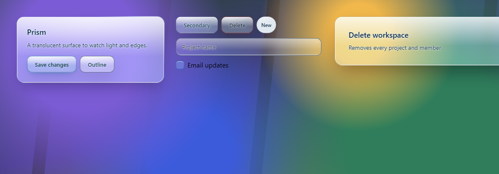 | 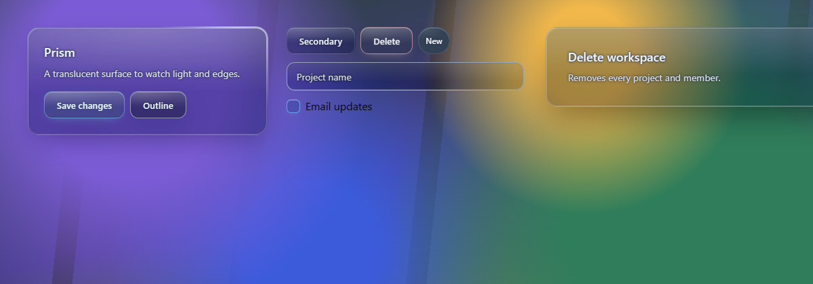 |
| Givré | 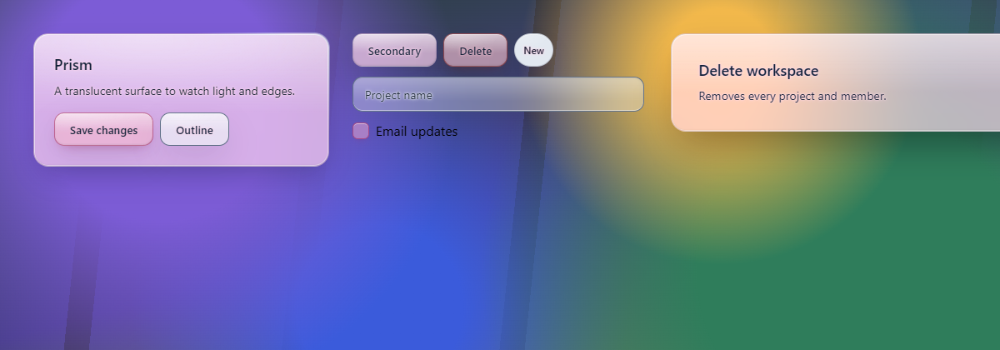 | 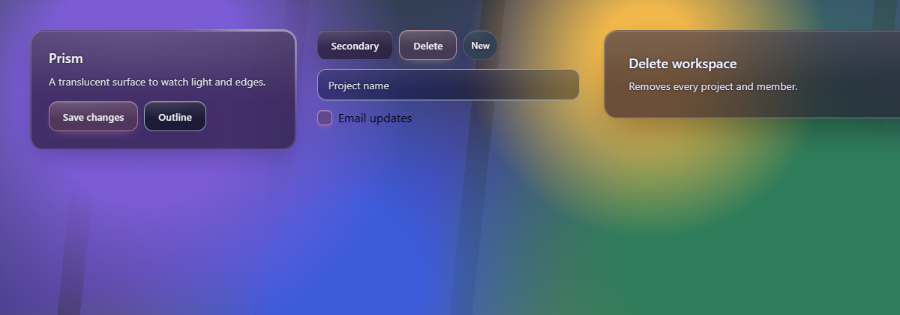 |
| Fumé | 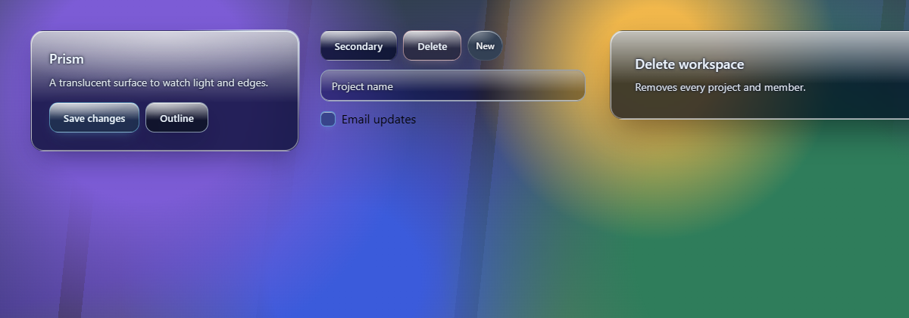 | 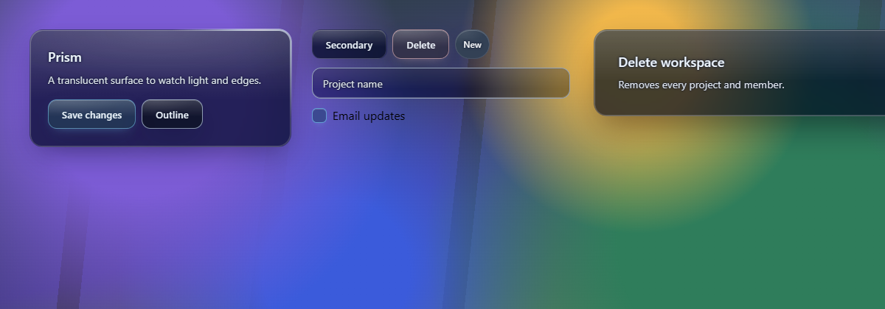 |
| Relief | 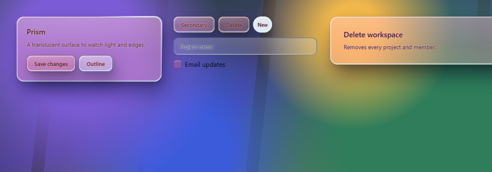 | 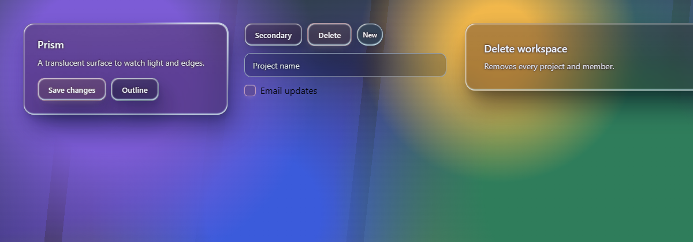 |
| Clear | 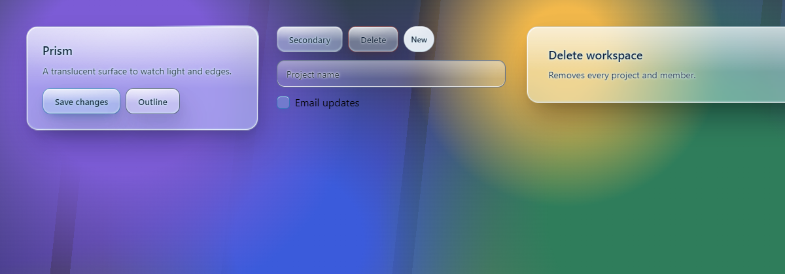 | 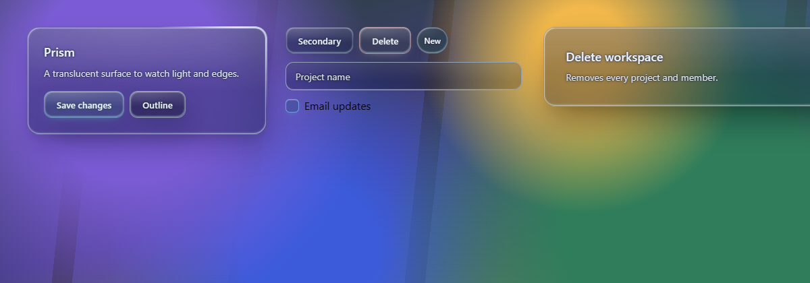 |
| Prism | 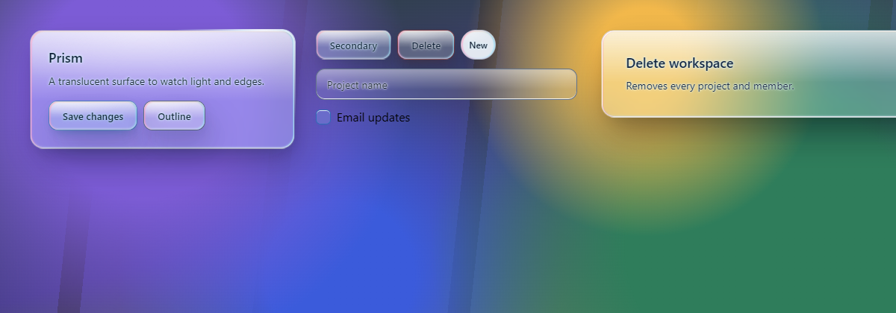 | 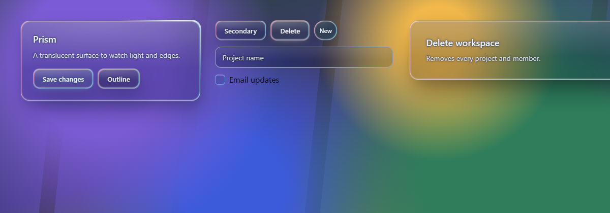 |
| Liquid | 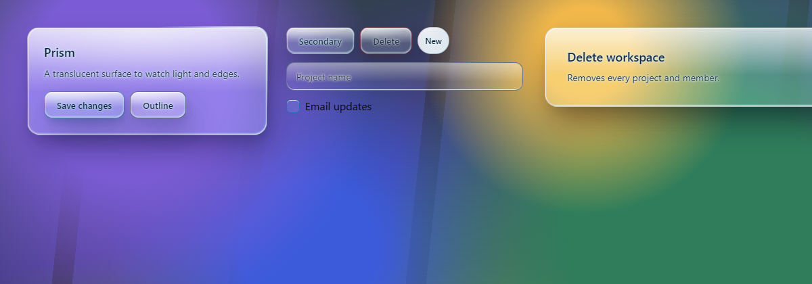 | 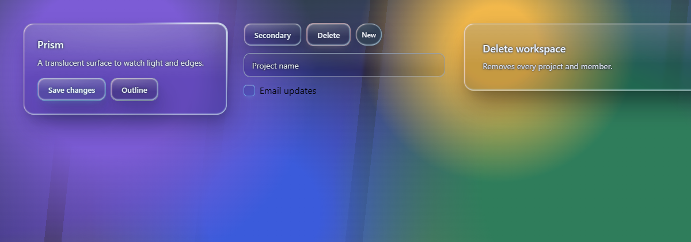 |
| Liquid glass | 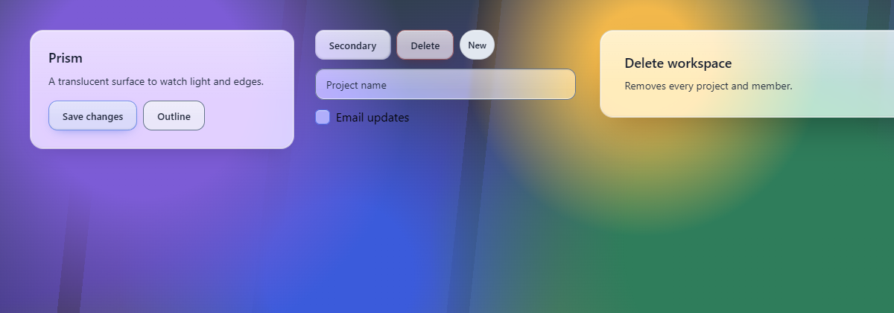 | 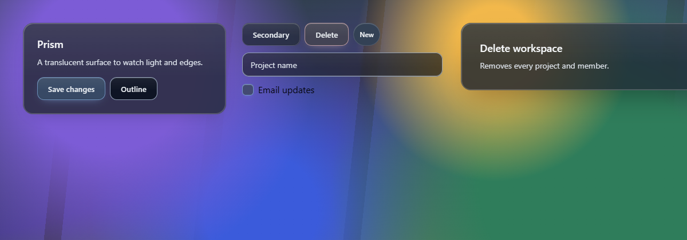 |

## Limits

- **Static pages:** these are not the www dev server. No `LiquidGlassFilter` is mounted, so rim refraction does not show; the halo is set by hand.
- **Relief backdrop:** Relief is shown on the kit backdrop. Its Pêche preview backdrop arrives with the editor work in PR 3.
- **The "Email updates" label:** it sits outside the glass and is unstyled harness markup.
