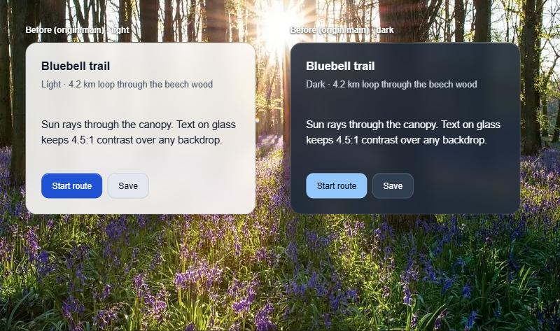
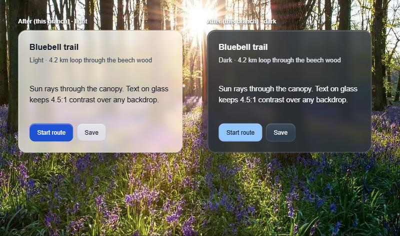

# Liquid glass verification

The experimental liquid glass family was verified on branch `feat/liquid-glass-style`, rebased onto `origin/main` at `406766b`. The post-rebase runs below used `fc41f5111c07cdeb905b68069c6ac54e451a3566`. They ran with this documentation change uncommitted and with generated schema and catalog files rewritten with LF line endings only (identical content). The environment was Windows 11 Home 10.0.26300, Node 24.19.0, pnpm 11.25.0 through `corepack pnpm`, and Playwright 1.64.1 with Chromium 156.0.4314.58 through the Edge channel. Bare `pnpm` is not on PATH here. For Playwright's server commands only, a local shim that forwards to `corepack pnpm` was put first on PATH. Bun is not installed, and Corepack has no cached Yarn 1.22.22 or 4.18.1.

A later fix-wave run on `3fce385` ran all 40 browser cases, including the 16 glass consumer cases. See [Fix-wave browser run](#fix-wave-browser-run).

`pnpm check:foundation` was **not** run, so this slice has no full-gate result. The [machine-readable run record](liquid-glass-run.json) has the commands, counts, durations, result hashes, and the list of what was not run.

## Glass realism run

Branch `feat/glass-realism` adds backdrop compression to the glass filter (`contrast()` and `brightness()` after `blur()` and `saturate()`), models it in the contrast bound, adds the specular sheen and edge light, and lowers the built-in `glassOpacity` from 0.87 to 0.5. It ran on 3 November 2026 in the environment above, with generated contract files restored to their committed line endings.

| Command | Result |
| --- | --- |
| `corepack pnpm typecheck` (after `build:packages` and `generate:preview`) | Passed |
| `corepack pnpm test:unit` | 81 files, 820 tests passed |
| `vitest run tests/integration/liquid-glass-cli.test.ts tests/integration/snapshot-api.test.ts` | 2 files, 42 tests passed |
| `playwright test tests/e2e/liquid-glass.spec.ts tests/e2e/preset-editor.spec.ts` | 38 of 50 passed in 4.2 min, including all 24 glass preview cases. The 12 downloaded-preset parity cases did not run: they need prepared npm consumers and npm 11.19.0, and this machine has npm 11.17.0 |

The browser run used Chromium 156 through the Edge channel, one worker, an empty consumer map, and the `corepack pnpm` shim described above. The glass consumer cases did not run, because no glass consumers were prepared. The 24 preview cases include the bounded-contrast probe, which now predicts each sampled pixel from the computed `backdrop-filter` and sheen gradient, and the reduced-transparency, no-`backdrop-filter`, forced-colours, and nested-filter fallbacks.

The stable-family byte-identity guard in `test:unit` found no change to flat, minimalist, or neo-brutalism output.

`packages/compiler/test/glass-contrast.test.ts` proves the filter model two ways. It checks the hand-computed range for `contrast(0.45) brightness(1.4)` and `brightness(0.6)`: light `[0.385, 1]` and dark `[0.165, 0.435]`. It then runs 1,508 backdrop colours, including the eight RGB cube corners, through a reference saturate, contrast, and brightness chain at saturation 1, 1.8, and 2. Every filtered channel stays inside the predicted range, and every painted text pair stays at or above both the reported worst ratio and 4.5:1 with no sheen, half sheen, and full sheen.

### Minimum opacity per palette

The lowest `glassOpacity` the bound allows, in 0.01 steps, with the built-in filter settings (contrast 0.45, tone 0.4, sheen 0.25):

| Palette | Light | Dark | Nested light | Nested dark |
| --- | --- | --- | --- | --- |
| Built-in liquid glass (this branch) | 0.50 | 0.28 | 0.70 | 0.79 |
| Same palette, no compression (contrast 1, tone 0, sheen 0.25) | 0.70 | 0.79 | 0.70 | 0.79 |
| Previous built-in glass palette, raw bound | 0.87 | 0.86 | — | — |
| Flat palette with the glass settings | 0.69 | 0.94 | — | — |
| Minimalist palette with the glass settings | 0.70 | 0.42 | — | — |
| Neo brutalism palette with the glass settings | 0.69 | 0.94 | — | — |

Only the liquid glass palette ships with the glass family; the other three rows show what the same filter settings would allow for the stable families' palettes, whose `mutedForeground` colours sit close to 4.5:1 on `muted`.

The previous palette's `mutedForeground` sat close to 4.5:1 on `muted` even when opaque, so no compression could make it thin. The branch darkens light `mutedForeground` to `#334155` and lightens dark `mutedForeground` to `#E2E8F0`, with `muted` at `#F1F5F9` and `#273449`.

### Card over the bluebell photo

The same Card and Buttons over the preset editor's backdrop photo, at 880 × 520 in the app's Chromium browser pane. Before uses the `origin/main` CSS and tokens; after uses this branch's compiler output.

## Post-rebase runs

These ran on `fc41f51` on 3 November 2026:

| Command | Result | Time |
| --- | --- | --- |
| `corepack pnpm typecheck` | Passed | 3 s |
| `corepack pnpm test:unit` | 81 files, 812 tests passed | 54 s |
| `corepack pnpm test:integration` | 441 passed, 30 failed, 23 skipped (494 tests in 64 files); exit 1 | 319 s |
| `corepack pnpm build:packages`, `corepack pnpm generate:preview` | Passed | — |
| `playwright test tests/e2e/liquid-glass.spec.ts` | 24 of 24 preview cases passed; nothing skipped or flaky | 66 s |
| `corepack pnpm exec vitest run apps/www/src` | 32 files, 268 tests passed | — |

The unit run includes the byte-identity guard. It compares 132 artifact hashes for flat, minimalist, and neo-brutalism compile output, plus scoped Button preset and recipe output, and found no change.

All 30 integration failures are environmental:

- 24 cannot find a native Bun executable;
- 5 need Yarn 1.22.22 or 4.18.1, which Corepack has not cached;
- 1, in `upstream.test.ts`, runs bare `pnpm add` through the pinned shadcn registry boundary, and `pnpm` is not on PATH.

No product test failed. The nine glass CLI cases in `tests/integration/liquid-glass-cli.test.ts` passed for pnpm and npm. They cover:

- `init` and `theme add` with the glass preset;
- adding each experimental component;
- `add input` refused before any write, with files, config, lock, and lockfile untouched;
- `init` with an unavailable component refused as a whole;
- the scoped glass Button preset and recipe;
- the experimental notice in dry-run output.

The browser run used one worker. Ports 3000 and 4173 were free before it. Playwright started and stopped its own preview and editor servers, and no listener remained on either port afterwards. `.artifacts/consumers.json` listed no prepared glass consumers, so the spec's 16 consumer cases did not run in this run. The fix-wave run below ran them.

## Fix-wave browser run

This ran on `3fce385c0e75e6862156e43b68d4538358916da8` on 3 November 2026, with the same environment and the same LF-only generated files. It followed the theme-switch refusals and the contrast readout change.

Only the two glass consumers were prepared, through `prepareNodeConsumer` for `vite-liquid-glass` (port 4208) and `next-liquid-glass` (port 4209), and built with `pnpm run build`. `.artifacts/consumers.json` held only those two rows. The Vite consumer prepared in 17.5 s and built in 3.0 s. The Next.js consumer prepared in 28.1 s and built in 10.3 s. Both audits exited 0.

After `corepack pnpm build:packages` and `corepack pnpm generate:preview`, the command was `OMBELLE_BROWSER_CHANNEL=msedge corepack pnpm exec playwright test tests/e2e/liquid-glass.spec.ts`, with the `corepack pnpm` shim first on PATH. All 40 cases passed: 24 preview cases and 16 consumer cases, with nothing skipped or flaky. The run took 118 s with one worker on Chromium 156.0.4314.58 through the Edge channel.

Ports 3000, 4173, 4208, and 4209 were free before the run, and no listener remained on them afterwards. The editor's Next.js server rewrote `apps/www/next-env.d.ts`, which was restored.

## Earlier runs

These runs took place before the rebase or on other commits:

- **Baseline.** Before the work, `test:unit` on `main` at `b68f8f1` passed 74 files and 730 tests.
- **Integration at `60a94f9`.** 435 passed, 31 failed, and 23 skipped in 448 s, including 9 of 9 glass CLI cases. Thirty failures had the same environmental causes as above. One was a real expectation in preview routing. It was fixed in the next commit and passes in the post-rebase run.
- **Browser at `9f70fa2`** (rebased as `1e282e9`). 24 of 24 preview cases passed in 70.2 s on Chromium 156.0.4314.58 through the Edge channel.
- **Glass consumers.** The pnpm Vite consumer prepared in 20.0 s and built in 2.7 s. The pnpm Next.js consumer prepared in 27.6 s and built in 11.3 s. Both audits exited 0. Each consumer installed exactly Button, Badge, Card, Dialog, Tabs, and Tooltip, and its 18 artifacts were byte-equal to the compile output. No browser case ran against these consumers; the fix-wave run used freshly prepared ones.

## What the browser spec checks

In light and dark mode, over the solid, gradient, and pattern backdrops, the 24 preview cases cover:

- axe scans of the six components;
- measured contrast of rendered text against the rendered surface, over black and white backdrops;
- a Button nested inside a glass Card dropping its own filter while the Card keeps its blur;
- reduced transparency, missing `backdrop-filter` support, forced colours, and reduced motion;
- focus visibility and 24px targets;
- the labelled placeholders for the six unavailable components;
- the preset editor glass flow: switching family, a failing opacity disabling export, and unavailable components greyed out.

## Measurements

Before the [glass realism run](#glass-realism-run), the built-in glass preset used `glassOpacity` 0.87, the smallest value at which both built-in palettes passed the raw black and white bound. The limiting pair is light `muted` with `mutedForeground`: 4.59:1 at 0.87 and 4.48:1 at 0.86.

In the browser run at `9f70fa2`, the worst measured contrast on a bounded pair was the inactive Tabs trigger: 4.60:1 in light mode over black, and 4.73:1 in dark mode over white. Sampled pixels matched the computed composites to within 1 per channel.

## Method notes

- Playwright has no reduced-transparency option. The spec emulates it through CDP `Emulation.setEmulatedMedia` and confirms it with `matchMedia`.
- Missing `backdrop-filter` support is simulated by stripping `@supports` blocks from four Vite-served CSS modules: `preview.css`, `ui/card.css`, `ui/tabs.css`, and `ui/tooltip.css`. This is not a run in a browser that lacks the feature.
- Under forced-colours emulation, axe reads author colours, and the flat family fails its colour-contrast rule in the same way. The spec disables only that rule there, and measures forced-colour contrast on the solid section instead.
- The scenario has no ghost Button, so the ghost variant was checked on an injected clone.

## Not run

- the full 36-consumer prepare and build matrix, which needs Bun and Yarn;
- `pnpm check:foundation`;
- the Bun and Yarn integration tests;
- bundled Chromium, Firefox, Safari, and previous browser majors;
- scrolling on a mid-range mobile device;
- human visual, keyboard, NVDA, and VoiceOver review.

## Limits

Glass stays experimental. The measured checks are automated, in one Chromium build on Windows. They do not establish stable status, application-level accessibility, or contrast for content that consumers place on glass. The [liquid glass](../components/liquid-glass.md#limitations) document lists all known limitations. The hosted snapshot service must be redeployed before glass codes resolve publicly.

## Known follow-ups

- The site redesign in PR #37 is not merged into this branch. It shows glass as "soon" or "not yet" in `apps/www/src/site/home/showcase.tsx` and `apps/www/src/site/home/sections.tsx`. Whichever of the two PRs merges second must change those to experimental for the six components.
- Run a full `pnpm check:foundation` on a machine with the complete toolchain. The glass consumer browser cases have run only in the fix-wave run above, with Edge rather than bundled Chromium.
- Redeploy the hosted snapshot service.
- Switching between stable families with `theme add` leaves previously installed colocated component CSS from the old family in place. This is pre-existing and not specific to glass.

See the [liquid glass documentation](../components/liquid-glass.md) and the [approved design](../superpowers/specs/2026-11-03-liquid-glass-design.md).
